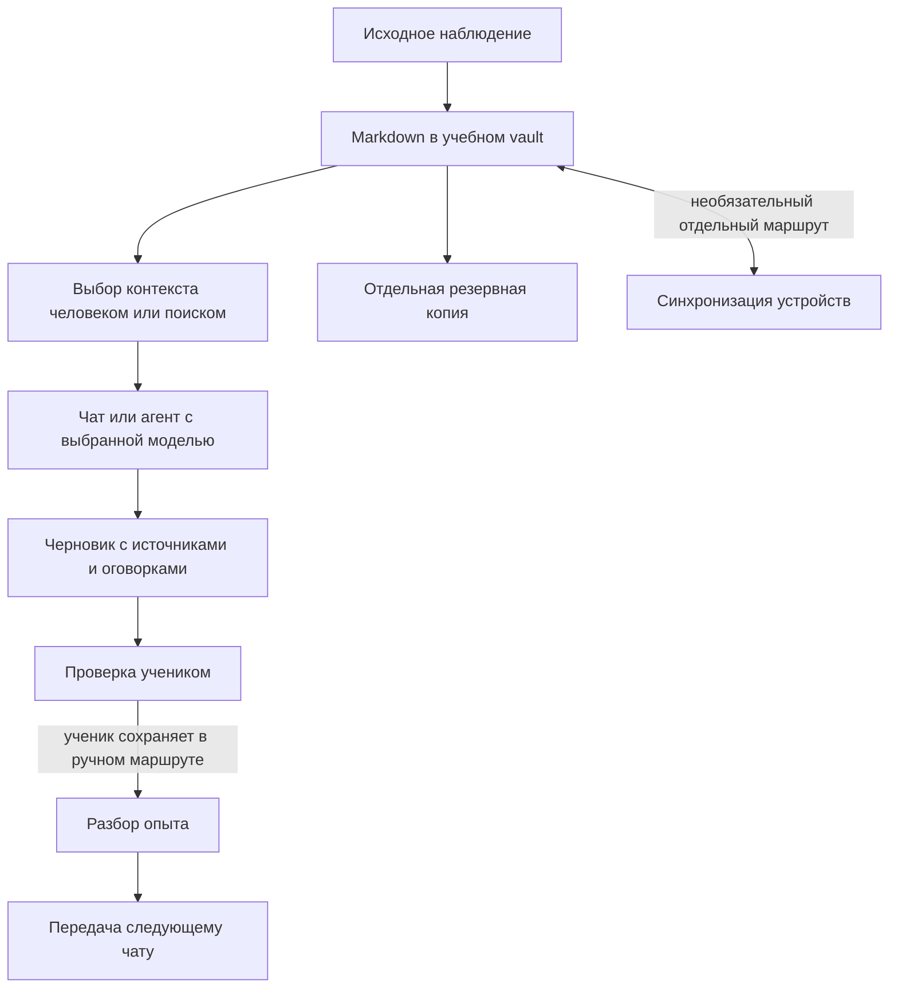

# Как устроена учебная система

Хранилище содержит опыт и источники. Программа доставляет выбранный контекст модели. Модель помогает подготовить разбор. Человек проверяет его и решает, что сохранить. В ручном маршруте ученик сам переносит текст в Obsidian; скрытой обратной записи нет.

## Четыре возможности, которые проверяются отдельно

| Возможность | Что делает ученик | Как проверить |
|---|---|---|
| Сохранить | Записывает исходное наблюдение и его источник | Исходный файл открывается, наблюдение не заменено выводом модели |
| Найти | Выбирает относящиеся к вопросу заметки | Можно показать путь и фрагмент, на котором основан ответ |
| Понять | Разделяет наблюдение, гипотезу и границы применимости | Разбор не добавляет события, которых нет в источнике |
| Применить | Выбирает следующий шаг и передаёт контекст другому чату | Новый чат по переданным файлам понимает задачу и ограничения |

Успех в одной строке не доказывает остальные. Возможность записать файл не измеряет качество поиска. Хорошее объяснение не подтверждает причинность. `reviewed` означает проверку человеком по указанным основаниям; сами основания также должны быть видны.

## Пути двух занятий

`01_projects/my-project/index.md` даёт контекст. `04_inbox/my-experience-source.md` хранит исходное наблюдение. Проверенный разбор сохраняется в `04_inbox/my-first-experience.md`. Следующий чат получает нужные файлы и `01_projects/my-project/handoff.md`.

История прежнего чата не становится общей памятью моделей. Для продолжения надо передать или явно прочитать актуальные файлы. Неизвестное остаётся неизвестным, даже если предыдущий ответ звучал уверенно.

## Варианты подключения, а не обязательная лестница

| Вариант | Где проходит граница | Когда полезен |
|---|---|---|
| Ручной обмен | Человек выбирает текст или файлы и сам сохраняет результат | Первый урок; небольшой объём контекста |
| Нативные файловые инструменты агента | Клиент и среда ограничивают операции с диском | Повторяемое чтение и подготовка новых черновиков |
| Официальный desktop CLI | Команды работают через приложение Obsidian | Нужны функции приложения, а не только Markdown-файлы |
| MCP или REST | Сервер проверяет клиента, операцию и путь | Нужен согласованный интерфейс инструментов |
| RAG | Индекс и поиск выбирают фрагменты для запроса | Нужный материал трудно найти вручную |

RAG можно сочетать с другими вариантами. Он не является отдельным разрешением на запись. Нативный файловый доступ не требует MCP; ручной обмен не требует плагина. Название модели не определяет права программы, которая её запускает.

CLI требует отдельной настройки и desktop runtime; Headless работает отдельно от приложения. Их наличие в продукте не доказывает включение на компьютере ученика. [CLI](https://obsidian.md/help/cli), [Headless](https://obsidian.md/help/headless).

## Где обеспечиваются ограничения

Правила в `AGENTS.md` и промпте объясняют порядок работы. Права клиента, сервера и среды исполнения ограничивают возможные действия. Если рядом остаётся инструмент с полным доступом к диску, ограниченный экспортёр не защищает от его операций.

MCP Roots являются контекстной подсказкой и помечены устаревшими; `readOnlyHint` описывает предполагаемое поведение. Режим чтения доказывается отказом менять закрытые данные, а не надписью в интерфейсе. [Roots](https://modelcontextprotocol.io/specification/2026-07-28/client/roots), [аннотации](https://github.com/modelcontextprotocol/modelcontextprotocol/blob/main/blog/content/posts/2026-03-16-tool-annotations.md).

Ключи находятся вне vault и материалов курса. Отдельно фиксируется маршрут индексирования и маршрут ответа: локальные embeddings не мешают последующей отправке найденных абзацев облачной модели. Отобранная заметка может содержать чужую инструкцию; её текст не получает права менять правила или читать соседние файлы.

## Если запись автоматизирована

Сначала агент создаёт предложение. Человек видит основания и изменения. Публикация разрешается только для нужного файла и актуальной версии. Для канона полезен один назначенный писатель; другие исполнители готовят отдельные предложения. Одновременное редактирование человеком всё равно требует проверки конфликтов.

Local REST API описывает условные записи с проверкой версии. Эта защита относится к операциям через API и не означает глобальную сериализацию внешних редакторов или shell. Простая проверка хеша перед обычным сохранением также оставляет промежуток гонки. [Local REST API](https://github.com/coddingtonbear/obsidian-local-rest-api).

Результат ученика подтверждается его собственными проверками из [ACCEPTANCE.md](ACCEPTANCE.md). Canary-тест преподавателя показывает только испытанный им маршрут и не засчитывает упражнение ученику. Поиск по смыслу, полезность передачи опыта и production wrap требуют отдельных проверок.
