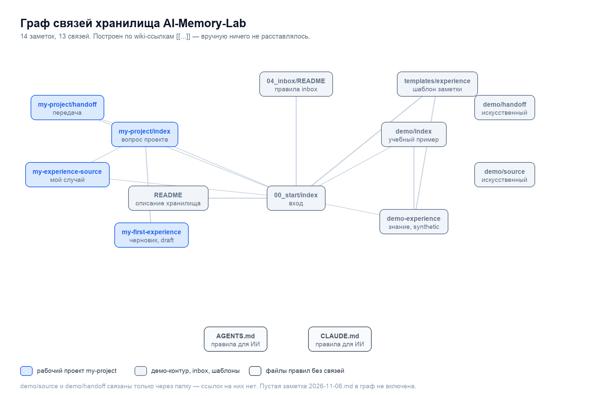

# Obsidian: архитектура и граф связей

Наш случай, не учебный: хранилище AI-Memory-Lab на этом Mac (`/Users/tatiana/AI-Memory-Lab`), Obsidian 1.15.0, 14 заметок с содержанием и один пустой файл. Логика простая: сырое наблюдение попадает в inbox, проверенное — в knowledge, у проекта есть вход, источник и передача. Связи задаются wiki-ссылками [[...]], поэтому граф строится сам, без ручной схемы.

## 1. Архитектура

| Папка или файл | Роль | Правило |
|---|---|---|
| 00_start/index | точка входа | маршрут по хранилищу и порядок уроков, ссылки на проекты и inbox |
| 01_projects/my-project | рабочий проект | три заметки: index (вопрос и состояние), handoff (передача), источник в inbox |
| 01_projects/demo | учебный пример | искусственные данные, показывают образец, а не мой опыт |
| 03_knowledge | знания | только проверенные выводы с указанием, откуда взялись |
| 04_inbox | сырьё | README с правилами; черновики здесь не считаются знанием |
| templates/experience.md | шаблон | единая структура заметки об опыте |
| AGENTS.md, CLAUDE.md, README.md | правила для ИИ | как читать хранилище, что нельзя выдумывать, как передавать контекст |

Каждая заметка начинается с YAML-шапки: type (index, project, handoff, source, experience), status, tags. В нашем хранилище сейчас так: draft — 5 заметок, active — 3, synthetic — 3, без шапки — 4 (это файлы правил и пустая заметка).

Статус не украшение. Пока владелец не сверил черновик с источником, стоит draft, и это видно и в графе, и в поиске: заметка my-first-experience честно помечена черновиком, reviewed в хранилище нет ни у одной заметки.

## 2. Граф связей

По ссылкам получается 14 узлов и 13 связей. Центр — 00_start/index: из него выходит 7 ссылок, он связывает маршрут с обоими проектами, inbox и шаблоном. Рабочий проект держится на трёх связях от my-project/index: к handoff, к исходному случаю и к черновику. Демо-контур стоит отдельно и связан только через demo/index → demo-experience — то есть по графу видно, что это образец, а не мой опыт.

Что граф показывает честно: у черновика my-first-experience нет ссылки в knowledge. Это не забывчивость, а состояние работы — переносить в знания нечего, пока вывод не проверен. Демо-образец такую ссылку имеет, потому что он искусственный.

Без связей остаются четыре файла: AGENTS.md и CLAUDE.md (правила, на них ссылаются словами, а не ссылками), demo/source и demo/handoff (на них завязан только путь папки). Плюс пустая заметка 2026-11-06.md — она появилась случайно и в граф не включена.

## 3. Чем наш случай отличается от школьного примера

| Школьный пример | У нас |
|---|---|
| путь B:\Obsidian\AI-Memory-Lab | /Users/tatiana/AI-Memory-Lab |
| 16 связей | 13 связей |
| связи черновика с knowledge есть | связи нет: сначала проверка, потом знание |
| граф описывает один проект | два контура: рабочий my-project и демо |

## 4. Как передать хранилище нейросети снова

1. Открыть новый чат и включить режим без памяти, если он есть.
2. Приложить четыре файла: AGENTS.md, 01_projects/my-project/index.md, 04_inbox/my-experience-source.md, templates/experience.md.
3. Попросить перечислить приложенные файлы и остановиться, если чего-то нет.
4. Попросить отделить факты с путями источников от предположений и неизвестного, не угадывать даты и числа.
5. Ответ вернуть исходным Markdown со свойствами type: experience и status: draft, сохранить новой заметкой в 04_inbox.

Если вложения не принимаются, скопировать текст из режима исходного кода и перед каждым текстом написать путь файла.

## 5. Как запустить «сотрудника» снова

У нас два комплекта: `agent-marketolog` (агент Вова, работает как рабочая папка) и `ii-marketolog` (ИИ-маркетолог «Маркет» с паспортом и навыками).

1. Открыть `agent-marketolog` рабочей областью — его AGENTS.md подхватывается сам.
2. Или приложить материалы явно: `agent-marketolog/AGENTS.md`, `agent-marketolog/polnomochiya.md`, `agent-marketolog/gotovnost.md`, `agent-marketolog/knowledge.md`.
3. Рабочий процесс и испытания — `ii-marketolog/employee.md`, `ii-marketolog/checks.md`, `ii-marketolog/zapusk.md`.
4. Результат складывать в `ii-marketolog/results/` и `agent-marketolog/results/`.

## 6. Что не сделано и что нужно от владельца

- Сверка черновика с личным кабинетом не проведена, поэтому ни одна заметка не переведена в reviewed.
- knowledge по нашему проекту пуст: проверенного вывода ещё нет, есть только демо-пример.
- Пустая заметка 2026-11-06.md — удалить или заполнить, решать владельцу.
- Синхронизация Obsidian не настроена, плагины не ставились: по уроку они не нужны, но между устройствами заметки сами не переносятся.
- От владельца нужны: решение по карточке на Адмирала Трибуца, 8 и тарифу, цифры заявок и конверсии, дата личной сверки.

## 7. Где лежат файлы

| Что | Путь |
|---|---|
| Хранилище Obsidian | /Users/tatiana/AI-Memory-Lab (00_start, 01_projects, 03_knowledge, 04_inbox, templates) |
| Черновик заметки | /Users/tatiana/AI-Memory-Lab/04_inbox/my-first-experience.md |
| Исходный случай | /Users/tatiana/AI-Memory-Lab/04_inbox/my-experience-source.md |
| Записка передачи | /Users/tatiana/AI-Memory-Lab/01_projects/my-project/handoff.md |
| Комплект агента | agent-marketolog/ (AGENTS.md, polnomochiya.md, gotovnost.md, knowledge.md) |
| Комплект маркетолога | ii-marketolog/ (employee.md, checks.md, zapusk.md, skills/) |
| Шаблон заметки | /Users/tatiana/AI-Memory-Lab/templates/experience.md |

## 8. Как я работаю с этим хранилищем

- Читаю заметки как обычные файлы и не считаю статус draft готовым результатом.
- Не ставлю reviewed: это решение владельца после сверки с источником.
- Новую заметку создаю только по задаче, с шапкой type, status, tags.
- Связи оформляю ссылками [[путь/без-расширения]], имена файлов — латиницей через дефис.
- Перед правкой существующей заметки делаю копию, чужой текст не переписываю.
- Файлы правил (AGENTS.md, CLAUDE.md) не редактирую без прямой просьбы.
