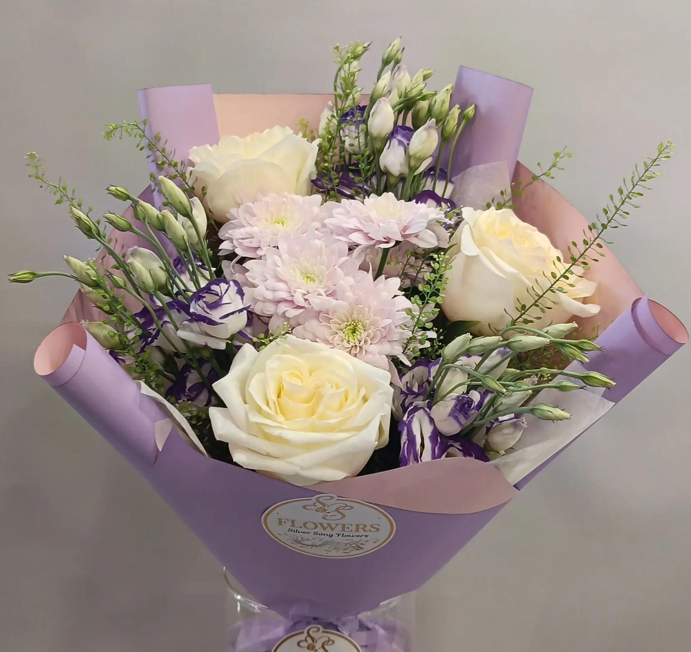

# Пост-знакомство в местных группах + Telegram-канал

**Дата:** 27.11.2026  
**Для:** Silver Song Flowers.  
**Районы:** Красносельский, Кировский, Невский (правый берег).  
**Магазины:** Трибуца, 8; Ленинский пр., 56; Белышева, 5/6.  
**Задача:** жители local-групп сами подписываются на Telegram-канал; мы не собираем их номера и не пишем в личку без согласия.

## 1. Главное условие

Пост размещаем **только с разрешения администратора группы** и по её правилам. Это не спам-рассылка: один пост-знакомство, без повторных сообщений, без массовых личных сообщений, без парсинга участников.

Подписка на Telegram-канал добровольная: человек сам нажимает ссылку. Номер телефона для этого не нужен. Если позже появится бот, который собирает имя/телефон, там понадобится отдельная галочка согласия и политика.

## 1.1. Ссылка

**Канал:** [https://t.me/S_S_FLOWERS](https://t.me/S_S_FLOWERS) — «Повод порадовать | СПб», канал Silver Song Flowers.

В цифровом посте ставим обычную ссылку: она кликабельна и не требует второго действия. QR-код в посте не нужен — его нельзя нажать. QR делаем для офлайна: витрина, чек, упаковка, листовка, доска в ЖК.

## 1.2. Фото для поста

Файл: [`buket-50.jpg`](../../arhiv/media-2026-11-26/foto-buketov/buket-50.jpg) — букет с логотипом Silver Song Flowers на упаковке. Светлый фон, читаемый логотип, не перегружен деталями.

## 2. Общий текст для городской группы

**Фото:** прикрепить [`buket-50.jpg`](../../arhiv/media-2026-11-26/foto-buketov/buket-50.jpg) первым — оно будет сверху поста, текст ниже. Это относится ко всем вариантам.

> Здравствуйте, соседи!
>
> Мы — цветочная мастерская **Silver Song Flowers**. Работаем в **Красносельском и Кировском районах**, а также в **Невском районе (правый берег)**.
>
> Наши магазины:
> • Трибуца, 8
> • Ленинский пр., 56
> • Белышева, 5/6
>
> Собираем букеты на каждый день и по поводу: день рождения, свидание, «просто так», 1 сентября, выпускной. Подскажем, что есть в наличии, и поможем выбрать.
>
> Чтобы не терять поводы и не звонить вам без спроса, мы ведём Telegram-канал «Повод порадовать»: букеты дня, идеи подарков и небольшие предложения для жителей района. Никаких звонков и спама — только цветы и поводы.
>
> 👉 Подписывайтесь: **https://t.me/S_S_FLOWERS**
>
> Если нужен букет сегодня — напишите в канал, подскажем, что есть.

## 2.1. Вариант для Красносельского и Кировского районов

> Здравствуйте, соседи!
>
> Мы — цветочная мастерская **Silver Song Flowers**. Наши магазины рядом:
> • Трибуца, 8
> • Ленинский пр., 56
>
> Работаем для **Красносельского и Кировского районов**: букеты на день рождения, свидание, «просто так», 1 сентября, выпускной. Подскажем, что есть в наличии, и поможем выбрать.
>
> Чтобы не терять поводы и не звонить вам без спроса, мы ведём Telegram-канал «Повод порадовать»: букеты дня, идеи подарков и небольшие предложения для жителей района. Никаких звонков и спама — только цветы и поводы.
>
> 👉 Подписывайтесь: **https://t.me/S_S_FLOWERS**
>
> Если нужен букет сегодня — напишите в канал, подскажем, что есть.

## 2.2. Вариант для Невского района (правый берег)

> Здравствуйте, соседи!
>
> Мы — цветочная мастерская **Silver Song Flowers**, магазин на **Белышева, 5/6**. Работаем для **Невского района, правый берег**: букеты на день рождения, свидание, «просто так», 1 сентября, выпускной. Подскажем, что есть в наличии, и поможем выбрать.
>
> Чтобы не терять поводы и не звонить вам без спроса, мы ведём Telegram-канал «Повод порадовать»: букеты дня, идеи подарков и небольшие предложения для жителей района. Никаких звонков и спама — только цветы и поводы.
>
> 👉 Подписывайтесь: **https://t.me/S_S_FLOWERS**
>
> Если нужен букет сегодня — напишите в канал, подскажем, что есть.

## 3. Короткий вариант для чата/сторис

> Соседи, мы цветочная мастерская **Silver Song Flowers**: Трибуца 8 и Ленинский 56 — для Красносельского и Кировского районов; Белышева 5/6 — для Невского, правый берег. Букеты на день рождения, свидание и «просто так». Telegram-канал «Повод порадовать» — без звонков и спама: **https://t.me/S_S_FLOWERS**

## 4. Закреплённый пост в Telegram-канале

> **Silver Song Flowers — цветы рядом с домом.**
>
> Магазины:
> • Трибуца, 8
> • Ленинский пр., 56
> • Белышева, 5/6
>
> Районы: Красносельский, Кировский, Невский (правый берег).
>
> Что здесь будет:
> — букеты дня и наличие;
> — идеи подарков и поводов;
> — небольшие предложения для подписчиков;
> — как заказать и забрать.
>
> Как заказать: напишите в этот канал или в **[контакт для заказа]**. Мы не звоним без вашего согласия и не рассылаем спам.
>
> **https://t.me/S_S_FLOWERS**

## 5. Как размещать

1. Написать админу группы: кто вы, что за пост, почему он полезен жителям, попросить разрешение.
2. Уточнить правила: можно ли ссылку на Telegram, можно ли закрепить пост, есть ли дни для рекламы.
3. Выбрать вариант: Красносельский/Кировский, Невский (правый берег) или общий.
4. Опубликовать **один** пост; не дублировать в комментариях и не писать участникам в личку.
5. Ответить на комментарии в течение дня; не спорить, не удалять критику.
6. Если админ против — не публиковать. Найти другую группу или договориться о другом формате (например, полезный пост «как выбрать букет» без ссылки).

## 6. Как измерить

- **Ссылка на канал:** по возможности сделать отдельную invite-ссылку для каждой группы (Telegram → управление каналом → ссылки) — тогда видно, откуда пришли.
- **Подписчики:** смотреть прирост за 24 часа и 7 дней после поста.
- **Заказы:** спрашивать «откуда узнали»; в канале — промокод `ГРУППА` или `СОСЕДИ`, если владелец подтвердит условия.
- **Таблица:** дата, группа, район, админ, ссылка на пост, просмотры, реакции, комментарии, подписки, заказы.

## 7. Что не делать

- Не парсить участников группы и не собирать их телефоны.
- Не писать в личку подписчикам без их согласия.
- Не постить в группы, где реклама запрещена.
- Не обещать скидку/подарок, который владелец не подтвердил.
- Не выдумывать цены, сроки доставки и наличие.

## 8. Что нужно от владельца

- Подтвердить: есть ли доставка, по каким районам, часы работы.
- Контакт для заказа в канале.
- Разрешённые условия для подписчиков (если будут): скидка, комплимент, подписка.
- Ссылка на канал уже есть: **https://t.me/S_S_FLOWERS**.

**Проверено:** ссылка открывается, канал «Повод порадовать | СПб» принадлежит Silver Song Flowers; адреса и районы подтверждены владельцем 27.11.2026; текст не собирает персональные данные. **Не проверено:** доставка, часы работы и актуальные цены — это нужно заполнить владельцу.
